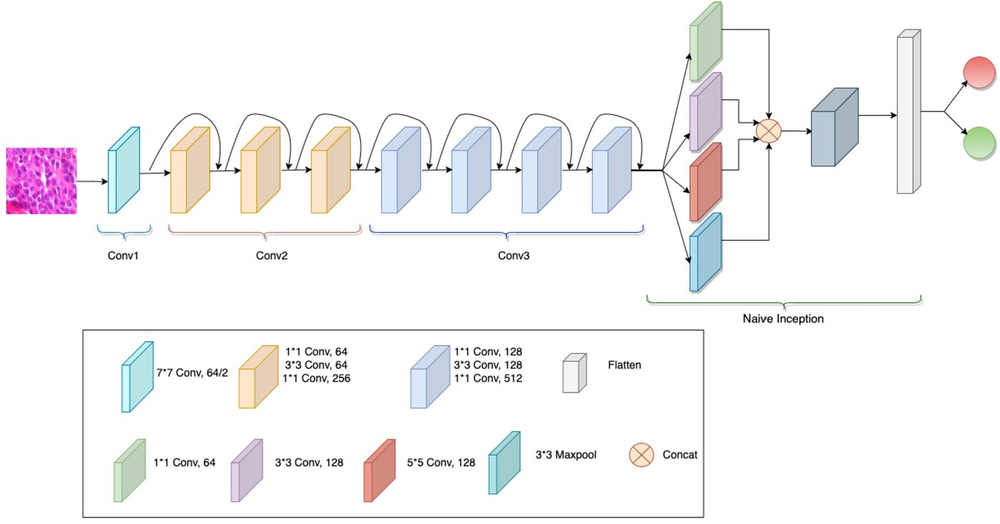
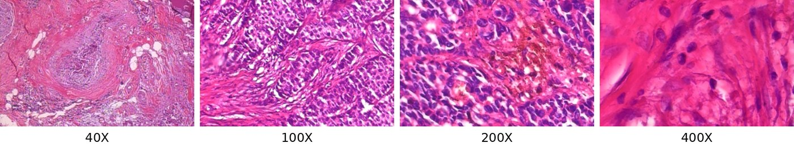
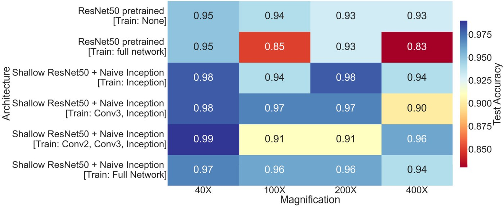
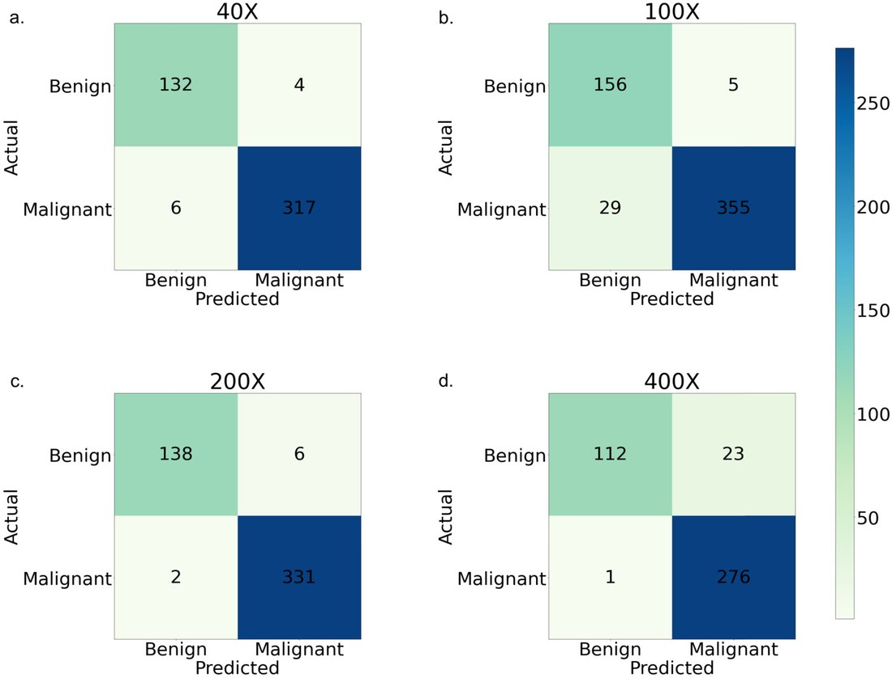

# Breast Cancer Histopathology Classification with Self-Supervised Contrastive Learning and a Lightweight ResNet–Inception Hybrid

[](https://doi.org/10.1016/j.heliyon.2024.e24094)
[](https://doi.org/10.1016/j.heliyon.2024.e24094)
[](https://web.inf.ufpr.br/vri/databases/breast-cancer-histopathological-database-breakhis/)


Experiment notebooks for

> **Enhancing breast cancer classification via histopathological image analysis: Leveraging self-supervised contrastive learning and transfer learning**<br>
> Faisal Bin Ashraf, S. M. Maksudul Alam, **Shahriar M. Sakib**<br>
> *Heliyon* 10(2), e24094, 2024 · [paper (open access)](https://doi.org/10.1016/j.heliyon.2024.e24094)

The official code release is maintained by the first author at [fbabd/Histopathological-image-breast-cancer-classification](https://github.com/fbabd/Histopathological-image-breast-cancer-classification). This repository holds a copy of the experiment notebooks.

<p align="center">
  
</p>
<p align="center"><sub><b>Proposed architecture.</b> ResNet50 is cut after its third stage (conv1–conv3), and a naive Inception block (parallel 1×1, 3×3 and 5×5 convolutions plus 3×3 max-pooling, concatenated) feeds a dense classifier. The model has about 3.6M parameters, against 23.8M for the full ResNet50. Figure 2 in the paper.</sub></p>

## Summary

Pathologists diagnose breast cancer by inspecting biopsy slides under a microscope. The work is slow and error-prone, and labeled slides are expensive to produce. The paper tackles benign-vs-malignant classification on the BreakHis dataset from two directions:

1. **Learning with few labels: self-supervised contrastive learning.** An ImageNet-pretrained ResNet50 is first trained on only 20% of the training split (16% of all data). After each epoch, unlabeled training images that the model labels with confidence above 0.90 are pseudo-labeled and added to the training set. This tests how far the model can get when most slides are unannotated.
2. **A smaller model: a ResNet–Inception hybrid.** The first three ResNet50 stages are kept, the last two (conv4, conv5) are dropped, and a naive Inception block is added on top. Four transfer-learning schedules are compared, ranging from training only the new head to training the whole network.

<p align="center">
  
</p>
<p align="center"><sub>BreakHis tissue at the four magnification levels used in the paper (Fig. 1). Each magnification is treated as a separate classification task.</sub></p>

## Results

Test accuracy by magnification (Table 4 in the paper):

| Method | Params | 40X | 100X | 200X | 400X |
|---|--:|--:|--:|--:|--:|
| DenseNet-169 (2018) | — | 0.94 | 0.95 | 0.96 | 0.89 |
| VGG16 + RBF-SVM (2021) | — | 0.96 | 0.96 | 0.96 | 0.96 |
| VGG16 + Inception (2023) | ~8M | 0.97 | 0.96 | 0.97 | 0.93 |
| Ours: contrastive (20% labels) | ResNet50 | 0.90 | 0.90 | 0.92 | 0.92 |
| **Ours: Shallow ResNet50 + Naive Inception** | **3.6M** | **0.98** | 0.94 | **0.98** | 0.94 |

At 40X and 200X the hybrid has the highest accuracy in the comparison, with less than half the parameters of the next-best model (VGG16 + Inception, ~8M). At 100X and 400X it trails the strongest models in the comparison: class-specific ResNeXt models (separate ~10.9M and ~13.5M models for the malignant and benign classes) and VGG16 + RBF-SVM.

<p align="center">
  
</p>
<p align="center"><sub>Test accuracy for each architecture and fine-tuning schedule (Fig. 4). Config 1 trains only the Inception block and classifier; Config 4 trains the whole network.</sub></p>

<p align="center">
  
</p>
<p align="center"><sub>Confusion matrices for Config 1 (Fig. 5). Out of 459, 545, 477 and 412 test images at 40X, 100X, 200X and 400X, the model misclassifies 10, 34, 8 and 24.</sub></p>

## Repository structure

```
├── proposed_ResNet50_Inception.ipynb   # proposed hybrid, fine-tuning configs 1–4 (Keras)
├── ResNet50_pretrained_trained.ipynb   # ResNet50 baselines: frozen vs. fully trained (Keras)
├── contrastive/                        # self-supervised contrastive learning (PyTorch)
│   ├── 40x_project_dl.ipynb
│   ├── 100x_project_dl.ipynb
│   ├── 200x_project_dl.ipynb
│   └── 400x_project_dl.ipynb
└── assets/                             # figures from the paper
```

## Running the notebooks

1. Download BreakHis from the [official page](https://web.inf.ufpr.br/vri/databases/breast-cancer-histopathological-database-breakhis/): 7,909 RGB images (700×460) from 82 patients, 2,480 benign and 5,429 malignant.
2. Split the images by magnification, with one folder per class (`benign/`, `malignant/`). Then set the data-path variables at the top of each notebook.
3. Install the dependencies:
   ```bash
   pip install tensorflow torch torchvision scikit-learn scikit-plot matplotlib numpy pillow
   ```
4. Preprocessing follows the paper: images are resized to 350×240 and cropped to 224×224, and augmented with shifts, flips and rotations.

Training settings from the paper:

- **Hybrid:** Adam, lr 1e-3, batch 128, 50 epochs per configuration. Fine-tuning uses a 1e-5 to 5e-5 learning-rate schedule with decay 0.8.
- **Contrastive:** Adam, lr 1e-3, batch 16, 11 epochs.

## My contribution

Per the paper's CRediT statement, my roles were data curation, investigation, validation, visualization, and writing the original draft.

## Citation

```bibtex
@article{ashraf2024enhancing,
  title   = {Enhancing breast cancer classification via histopathological image analysis:
             Leveraging self-supervised contrastive learning and transfer learning},
  author  = {Ashraf, Faisal Bin and Alam, S. M. Maksudul and Sakib, Shahriar M.},
  journal = {Heliyon},
  volume  = {10},
  number  = {2},
  pages   = {e24094},
  year    = {2024},
  doi     = {10.1016/j.heliyon.2024.e24094}
}
```

<sub>Figures are reproduced from the paper, which is published open access under CC BY 4.0. The BreakHis dataset belongs to its authors; see its page for terms of use.</sub>
